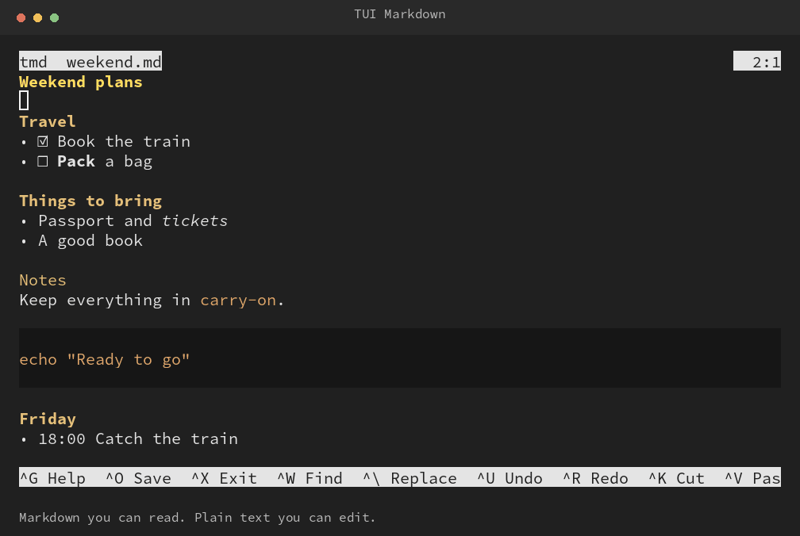

<p align="center">
  
</p>
<h1 align="center">TUI Markdown</h1>
<p align="center"><strong>Markdown you can read. Plain text you can edit.</strong></p>
<p align="center">A small terminal editor with nano-style controls and Markdown right where you type.</p>
<p align="center"><a href="#quick-start">Quick start</a> · <a href="#keys">Keys</a> · <a href="#how-it-feels">How it feels</a> · <a href="#development">Development</a></p>

<p align="center">
  
</p>

## Quick start

From this checkout, with Go 1.22 or newer:

```sh
go install ./cmd/tmd
tmd notes.md
```

Go installs the binary into `GOBIN`, or `$(go env GOPATH)/bin` when `GOBIN` is
unset. Add that directory to your `PATH` if needed. To build locally instead:

```sh
go build -o bin/tmd ./cmd/tmd
./bin/tmd notes.md
```

To print formatted Markdown without opening the editor, use `tmd --render`:

```sh
tmd --render notes.md
some-command | tmd --render
```

This reads a file or stdin (`-` also selects stdin), renders ordinary Markdown,
and hides code fences and language labels while preserving their contents and
whitespace. Code uses one style with a dark background and no language-specific coloring.
Output uses terminal styles when printed to a terminal
and plain text when redirected. Render input can use any file extension.

With Make available, `make build` and `make install` also stamp the version from
`VERSION`. `tmd --help` shows all controls; `tmd --version` identifies
the build. Run it without arguments to show help.

## How it feels

Read headings, **bold**, *italic*, inline code, lists, task checkboxes, and tables as
Markdown. Move onto a line and its source appears, ready for ordinary text
editing. Leave the line and it renders again. Your document stays Markdown
throughout; there is no conversion step.

Level-one headings use bold, bright yellow text. Levels two and three use bold
gold text, and levels four through six use gold text without added emphasis.

```text
tmd  notes.md *                                      4:12

Weekend plans
• ☑ Book the train
- [ ] **Pack** a bag       ← current line exposes its source
• ☐ Leave a note

^G Help  ^O Save  ^X Exit  ^W Find  ^\ Replace  ^U Undo
```

*Illustrative terminal layout; colors and text styles depend on your terminal.*

- **One document, one screen.** No modes to memorize or plugin setup.
- **Text editing.** Type, delete, paste, undo, and redo. No formatting toolbar,
  automatic bullets, or checkbox toggle commands.
- **Search and replace.** Literal, case-sensitive search wraps through the
  source. Confirm replacements individually or replace all remaining matches
  in one undoable edit.
- **Room to write.** Long lines wrap on screen without adding line breaks.
  Grapheme-aware navigation handles combining characters, wide text, and emoji.
- **Explicit saves.** Keep control of when your work reaches disk; exit offers
  save, discard, or cancel.

## Keys

| Key | Action |
| --- | --- |
| Arrow keys | Move the cursor |
| Home / End | Start / end of the source line |
| Page Up / Page Down | Move by a page |
| Enter / Tab | Insert a line break / tab |
| Ctrl+O | Save; edit the prompted path to Save As |
| Ctrl+X | Exit, with a choice for unsaved changes |
| Ctrl+W | Find literal text |
| Alt+W | Find the next match |
| Ctrl+\ | Find and replace |
| Ctrl+U / Ctrl+R | Undo / redo |
| Ctrl+K | Cut the whole source line |
| Alt+6 | Copy the whole source line |
| Alt+K | Delete the whole source line |
| Ctrl+V | Paste the editor's internal clipboard at the cursor |
| Ctrl+G | Open help |
| Esc / Ctrl+C | Cancel a prompt |
| Ctrl+U (inside a prompt) | Clear the current prompt |

Line cut/copy includes the line break when present and uses an internal clipboard.
Cut, delete, and paste can each be undone with Ctrl+U. Wrapped lines are treated
as one source line. For system clipboard copy/paste, use your terminal's usual
shortcuts. With a terminal that supports bracketed paste, tmd buffers the incoming
text and inserts it as one undoable edit when the paste ends, then redraws the
screen. Pasted control characters do not trigger editor commands. In text prompts,
line breaks become spaces and other control characters are removed.
Checkboxes are visual indicators: edit `[ ]` or `[x]` on the active line.

## Your file stays yours

Open `.md`, `.markdown`, or `.mdx` files, including paths with spaces. A missing
file starts as an empty buffer and is created only when you save it. No Git
checkout or background service is required.

Existing line endings, final-newline state, untouched Markdown source, and file
permissions are preserved. New files use permission mode `0600`. Saves stage a
temporary file beside the destination before installing it atomically.
External edits reload automatically when you have no unsaved changes.
Otherwise, tmd retains your buffer and offers Save As, reload and discard your
edits, or cancel to keep editing. Saving over a file that changed on disk is
blocked; use Save As with a new destination. Save As never overwrites another
existing file.

Pipe tables render with aligned columns, bold headers, and inline formatting.
Use colons in the delimiter row for left, center, or right alignment. The active
row reveals its original Markdown, including the delimiter row, for editing.

Fenced code hides its fences and language label; the contents stay literal and
use a uniform code style. Fence lines remain as blank rows in the editor so you
can move onto them to reveal and edit the source. Other Markdown features such
as HTML, images,
and link destinations remain visible as source rather than becoming a full
document preview. Files must be regular UTF-8 text; directories, symlinks, and
binary data are rejected.

## Development

```sh
go test ./...
go test -race ./...
go test ./internal/editor -run '^$' -fuzz FuzzMarkdownLayout -fuzztime 10s
```

The terminal layer uses tcell, Markdown parsing uses Goldmark, and grapheme
handling uses uniseg. Everything builds with CGO disabled. The test suite covers
document edits, rendered/source cursor mapping, simulated-screen interaction,
search/replace, saving, and external-file conflicts.

`make release` builds Linux and macOS binaries for amd64 and arm64 into
`dist/<version>/`, with a `SHA256SUMS` file. It builds local artifacts only.
